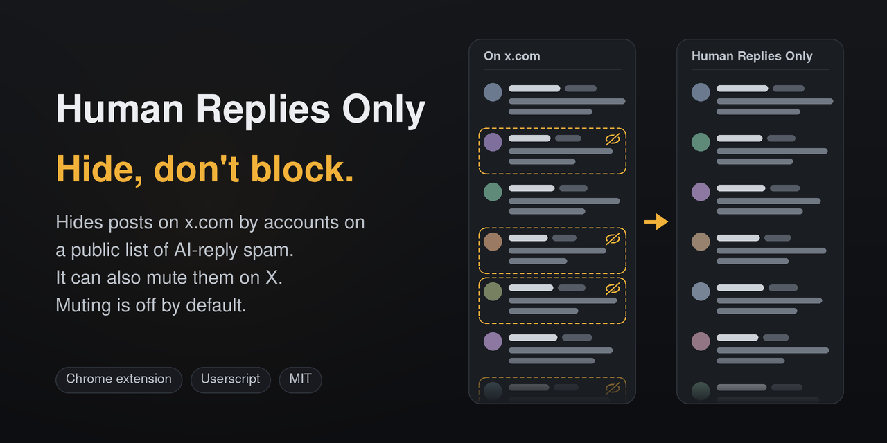

# Human Replies Only

Formerly x-slop-hide. The project, its repository and the extension were
renamed in 0.7.0; links to the old repository redirect here.

Human Replies Only hides posts on x.com whose author is on
[clankwall](https://clankwall.vogel.dev/)'s public list of AI-reply spam
accounts, and can also mute those accounts on your X account. You can add
accounts of your own, choose Show, Hide or Mute for each of six answer bots
such as @grok and @AskPerplexity, and hide posts that tag one of those bots.
In the extension you can also [label replies](#labels) Slop or Not slop.

Hiding works on the page in your desktop browser, in this browser profile
only, and the Pause switch shows the posts again. Muting is off until you turn
it on in the extension's popup. It then mutes up to 25 accounts a day (or 50 or
100, which run only while you have x.com open) by clicking X's own Mute on
x.com, so the mutes apply in the X app too. It never blocks anyone, never
unmutes, and does not use the X API. It is free and MIT-licensed.

Muting is automation of the X website, which X's rules say "may result in the
permanent suspension of your account". Read [Muting](#muting) before you turn
it on.

The list is read from `https://clankwall.vogel.dev/api/usernames.txt`, the
"Plain text" link under clankwall's "AI flags" heading. It held 369 handles on
2026-11-03, 767 on 2026-11-06 and 773 on 2026-11-08. clankwall's separate
"Spam flags" table (2,738 accounts on 2026-11-06) is not used. Human Replies Only
does not maintain the list; see [Whose list is it?](#whose-list-is-it).

To install, open the
[userscript](https://raw.githubusercontent.com/StartupBros-com/human-replies-only/main/dist/x-slop-hide.user.js)
in a userscript manager (tested with Violentmonkey; Tampermonkey is untested),
or load the Chrome extension unpacked. Both are under [Install](#install). Only
the extension mutes; the userscript hides.

## On a real thread

On 2026-11-03, on a reply thread with 251 replies, Human Replies Only hid 12 of the
118 distinct posts that loaded. All 12 were by listed authors, and no post by a
listed author was left showing. [docs/TESTING.md](docs/TESTING.md) has the
method and three more pages.

## Hide, mute or block

Hiding acts only on the page in your browser. The extension's muting, and X's
own Mute and Block, act on your X account.

| | Hiding | Muting with Human Replies Only | Mute on X | Block on X |
|---|---|---|---|---|
| Changes your X account | No | Yes: it is X's Mute | Yes | Yes |
| Applies in the X app | No | Yes | Yes | Yes |
| Covering a list of hundreds | Install once; the list refreshes itself | 25 accounts a day by default, so the 773 listed on 2026-11-08 take about a month; 8 days at 100 a day | Mute each account from its post or profile | Block each account from its post or profile |
| The account can find out | No | No, as with Mute on X | No: "Muted accounts will not know that you've muted them" | Yes: if it visits your profile, "they will see they have been blocked" |
| Undo | Pause, or add the handle to Always show | Unmute each account on X; Human Replies Only never unmutes | Unmute each account | Unblock each account |

The Mute and Block columns come from X's help pages on
[muting](https://help.x.com/en/using-x/x-mute) and
[blocking](https://help.x.com/en/using-x/blocking-and-unblocking-accounts),
read on 2026-11-06. Hiding cannot reach the X app on your phone; muting can,
because the mutes are X's own.

## Install

### Extension (Chrome or another Chromium browser, desktop)

1. Download the `.zip` from the
   [latest release](https://github.com/StartupBros-com/human-replies-only/releases/latest)
   and unzip it. Or `git clone https://github.com/StartupBros-com/human-replies-only`
   for the code on `main`, which can be ahead of the release.
2. Open `chrome://extensions` (`brave://extensions` in Brave) and turn on
   **Developer mode**.
3. Click **Load unpacked** and pick the folder that contains `manifest.json`.
4. Open x.com, then click the extension's icon: a red square with a
   crossed-out speech bubble. If it is not on the toolbar, open the
   puzzle-piece **Extensions** button and click the pin next to Human Replies Only.
   The popup shows how many accounts are listed and when the list was last
   updated.

An unpacked extension does not update itself. To get a new version, copy its
files into the folder you loaded before, replacing the old ones (or `git pull`
in a clone), then click the reload arrow on the extension's card. Your
settings, lists and mute record stay. The browser keys an unpacked extension's
storage to its folder, so loading a new version from a different folder adds a
second copy that has none of them, and leaves both running. That holds across
the rename too: copy 0.7.0 into the folder you loaded x-slop-hide from. The list
itself refreshes without any of this: on install, on browser start when it is due,
and every 6 hours.

#### Moving to a web store copy

Human Replies Only is not in a web store yet. When it is, a store copy will be a
different extension to the browser, with its own id and its own storage, so
nothing carries over from an unpacked copy: not your settings, your **Always
show** and **Also hide** boxes, the mute record or your labels. Both copies run
until you remove one, and with muting on in both, both mute. To switch:

1. In the unpacked copy's popup, open **Your accounts**, click **Export or
   import**, then **Export settings** (0.6.0 or later; in an older copy, copy
   the two boxes somewhere instead). Click **Export labels** too if you keep
   labels. There is no label import, so that file is your record of them, not
   a way to move them.
2. Remove the unpacked copy in `chrome://extensions`. This deletes its labels.
3. Install the store copy and import the settings file the same way (see
   [Export and import](#export-and-import)). Then set **Mutes a day** and, if
   you used it, muting again: a settings file carries neither.

The store copy starts a new mute record. Accounts the unpacked copy already
muted are visited again and found already muted, without a click. Each of
those visits counts against the day's visit cap (twice your **Mutes a day**),
so with a long list it can take several days to reach accounts that are not
muted yet. Mutes already made stay on your X account either way.

### Userscript (Violentmonkey or Tampermonkey)

Install a userscript manager (the script was tested in Violentmonkey 2.50.0;
Tampermonkey is untested), then open
<https://raw.githubusercontent.com/StartupBros-com/human-replies-only/main/dist/x-slop-hide.user.js>.
The manager offers to install it. Inside the manager the script keeps its old
name, x-slop-hide, and its old namespace: managers know a script by those two,
and a renamed script can install as a second copy instead of updating. In Chrome and other Chromium browsers, the
manager also needs **Allow User Scripts** turned on under **Details** on its
card in `chrome://extensions`; it is off in a new profile.

The manager checks that URL for updates and installs one when its version
number goes up. The script fetches the list when an x.com page opens and the
stored copy is more than 6 hours old, and checks again every 15 minutes and
whenever the tab comes back into view. The userscript does not mute.

## Controls

| To | In the extension popup | In the userscript menu |
|---|---|---|
| Show everything for a while | Tick **Pause hiding** | **Pause / resume hiding** |
| Always see an account | Under **Your accounts**, add its handle to **Always show these accounts**, then click **Save** | **Edit always-show list** |
| Hide an account that is not on the list | Under **Your accounts**, add its handle to **Also hide these accounts, and mute them when muting is on**, then click **Save** | **Edit extra accounts to hide** |
| Show, hide or mute an answer bot | Pick **Show**, **Hide here** or **Mute on X** in its row under **Bots that answer when tagged** (see [Bots](#bots)) | **Show / hide @grok**, or **Show or hide a bot** for any of the six; there is no Mute |
| Hide posts that tag a bot | Under **Bots that answer when tagged**, tick **Also hide posts that tag a bot set to Hide or Mute** | **Hide / show posts that tag a hidden bot** |
| Fetch the list now | **Refresh list now** | **Refresh list now** |
| Mute listed accounts on your X account | Tick **Mute listed accounts on X** (see [Muting](#muting)) | Not available |
| Mute more accounts a day | Pick 50 or 100 under **Mutes a day** (see [How many a day](#how-many-a-day)) | Not available |
| Label replies Slop or Not slop | Under **Label replies**, tick **Show Slop and Not slop buttons under replies on x.com** (see [Labels](#labels)) | Not available |
| Back up or move your settings | Under **Your accounts**, click **Export or import**, then **Export settings**; import the file on the same page (see [Export and import](#export-and-import)) | Not available |
| Share Also hide, or add a list someone shared | Under **Your accounts**, click **Export or import**, then **Export Also hide as a list**, or pick their file under **Import** | Not available |

**Bots that answer when tagged**, **Your accounts** and **Label replies** start
folded; click a heading to open it. A folded heading shows its counts, such as
"Show 5 · Hide here 1 · Mute on X 0", "Always show 2 · Also hide 0" or "On ·
12 saved".

**Save** saves both boxes at once. On an x.com tab, the popup opens with the
count of what it hid there, "N posts hidden on this tab", and under it "From M
accounts." It adds "Plus N posts that tag a bot." when tag hiding hid any, then
"K on screen now.", which counts both. When tag hiding hid posts and the list
hid none, the count is of those posts, with "Each one tags a bot. K on screen
now." On a tab it cannot count, another site
or an x.com tab opened before the extension was installed or reloaded, it says
"Open x.com in this tab to see what was hidden. If it is already open, reload
the tab." While hiding is paused, an x.com tab says "Hiding is paused". The
userscript has no counter.

## What gets hidden

- A post is hidden when its own author is on the list or in **Also hide these
  accounts**. The author is read from the post's name block,
  case-insensitively.
- A post that quotes a listed account, or @-mentions one, stays visible. Only
  the author counts, except for the bot tags described under [Bots](#bots).
- A repost carries the original author's name block, so it should be judged by
  the original author and hidden when that author is listed. This has not been
  checked against a live repost yet.
- On any page under a listed account's handle (its profile `/handle`,
  `/handle/with_replies`, one of its posts `/handle/status/...`, and so on),
  that account's posts stay visible, since you went there on purpose. Other
  listed accounts replying there are still hidden.
- Handles in **Always show these accounts** are never hidden, and
  **Pause hiding** shows every post until you untick it.

### Bots

The popup has a row for each of six accounts that answer when someone tags
them: @grok (X's assistant), @AskPerplexity, @pangram (an AI-text
detector), @bot (xAI's Grok Bot), @threadreaderapp and @UnrollHelper (thread
unrollers). Each row links to the bot's profile, where you can block it, and
offers three choices:

| Choice | The bot's own posts | With muting on |
|---|---|---|
| **Show** | Shown | Not muted |
| **Hide here** | Hidden in this browser | Not muted |
| **Mute on X** | Hidden in this browser | Muted on your X account, like a listed account |

- A bot you have not set follows the list: **Hide here** if clankwall lists it
  or it is in **Also hide these accounts**, **Show** if not. On 2026-11-08 the
  list had 773 handles and @grok was the only one of the six on it, so @grok
  starts at **Hide here** and the other five at **Show**. A bot is never muted
  until you pick **Mute on X** in its row.
- A bot in **Always show these accounts** is shown and never muted; its row is
  locked to **Show**.
- If you ticked **Show @grok's replies** in an earlier version, @grok's row
  starts at **Show**.
- On a bot's own pages its posts show, as on any account's.

Ticking **Also hide posts that tag a bot set to Hide or Mute** also hides
posts whose own text links one of the bots set to **Hide here** or **Mute on
X**, such as a reply that reads "@grok is this true?". Then:

- A tag inside a quoted post does not count, and neither does the "Replying
  to" line above a post.
- Your own posts, posts by Always-show accounts, posts on the author's own
  pages, and posts on the pages of a bot set to **Hide here** or **Mute on X**
  stay visible.
- These posts are counted apart from the listed authors' posts, and their
  authors are never muted for the tag.

On 2026-11-06, in an X search for "@grok is this true", each of the 10 posts
read had the `/grok` link in its own text and none in its "Replying to" line,
which named the account being answered.

All of this applies in this browser only. To keep a bot's replies out of the
X apps as well, add its handle (such as @grok) as a
[muted word](https://x.com/settings/muted_keywords) on X; Human Replies Only does not
add muted words.

## Muting

Muting is in the extension only, and it is off until you turn it on.

### Before you turn it on

Under "Don't!", X's
[automation rules](https://help.x.com/en/rules-and-policies/x-automation)
list: "Use non-API-based forms of automation, such as scripting the X website.
The use of these techniques may result in the permanent suspension of your
account." (read on 2026-11-06, unchanged on 2026-11-08). Muting with
Human Replies Only scripts the X website, and the popup says so under the switch.
Turn it on only if you accept that risk for the account you mute from.

A listing can be a mistake (clankwall's homepage says "Flags aren’t proof of
AI use."), and Human Replies Only mutes every listed account it reaches, including
one listed by mistake. Accounts you follow are skipped. Look through the
[list](https://clankwall.vogel.dev/api/usernames.txt) for accounts you know
and add them to **Always show** first: undoing a mute means unmuting the
account on X yourself, because Human Replies Only never unmutes.

### Turning it on

1. Under **Your accounts**, add every listed account you never want muted to
   **Always show these accounts**, and click **Save**. Accounts there are
   never hidden and never muted. Everything under **Also hide these
   accounts** is muted too, so take out any account there that you only want
   hidden. The exception is one of the six bots under [Bots](#bots): it
   follows its row, so it is muted only when that row says **Mute on X**.
2. Open x.com in a tab, logged in as the account to mute from.
3. From that tab, open the popup and tick **Mute listed accounts on X**. The
   popup asks the tab which account is logged in and ties muting to that
   account. If it cannot tell, it leaves the box unticked and says "Open x.com
   in this tab, logged in as the account to mute from, then turn this on."

Unticking the box starts no new visits. A visit already under way either
finishes, and is recorded like any other, or is dropped when its 90 s are up
and its tab closed. So one more mute can land just after you untick.

### What it does

- Once a minute, the background worker checks whether a visit is due. When one
  is, it opens the account's profile in a new background tab. The tab shows in
  your tab strip but never takes focus. Leave it alone: closing it counts as a
  failed visit.
- In that tab, Human Replies Only waits for one of the account's own posts with a ⋯
  button, opens that menu, and clicks the item labelled exactly
  "Mute @handle" (or "Mute"). It waits for X's "has been muted" notice, then
  closes the tab.
- One tab at a time. The next one opens at the first once-a-minute check that
  comes 1 to 3 minutes (picked at random) after the last tab closed, so about
  1 to 4 minutes later. At most 25 mutes and 50 profile visits a day, or the
  number you pick under **Mutes a day** and twice that many visits (see
  [How many a day](#how-many-a-day)). Days are UTC days.
- After every 5 mutes, and when the day's caps are reached or nothing is left
  to visit, it opens `x.com/settings/muted/all` the same way and checks that
  each new mute is listed there.
- Accounts it may mute whose posts it hid while you browsed go first (it keeps
  the latest 50), then the rest of the list in its order, then your extra
  accounts in alphabetical order, then bots set to **Mute on X**, then
  accounts being tried again.

It mutes only accounts on the list, accounts under **Also hide these
accounts**, and bots whose row says **Mute on X**. It never mutes a bot left at
**Show** or **Hide here**, including @grok, which is on the list (muting it
account-wide is a much bigger step than hiding its replies); an account in
Always show; an account you follow; or someone whose post was hidden only for
tagging a bot. When X's menu offers "Unfollow @handle", Human Replies Only
records that you follow the account and moves on. An account that is already
muted is recorded without a click. Human Replies Only never unmutes and never blocks.

### How many a day

Under **Mutes a day** the popup offers 25, 50 and 100.

- 25 is the default. It runs whenever the browser is open with the extension
  loaded, as in earlier versions.
- At 50 or 100, a mute visit starts only while you have x.com open in a tab of
  your own. Before each visit, the background worker asks your open tabs, and
  goes ahead only if the extension's script on an x.com page answers within
  1.5 s. The tabs it opens for its own visits never count, nor do tabs the
  browser has discarded to save memory. Without such a tab it waits; a check of
  `x.com/settings/muted/all` that is due still runs.
- The 1 to 3 minute gap between visits is the same at every setting, and visits
  stay capped at twice the mute number. So 100 mutes need about 2 to 7 hours of
  x.com being open.
- No setting goes above 100, and a stored value other than 25, 50 or 100 counts
  as 25. Hiding already covers this browser, so muting only adds the X apps;
  at 100 a day, the 773 accounts listed on 2026-11-08 take 8 days. The popup
  shows that figure for the accounts it has left to mute.

A lower number means less scripted clicking on your account each day. No
number makes it allowed: X's rules forbid scripting the X website at any rate
(see [Before you turn it on](#before-you-turn-it-on)). X publishes no limit for
mutes, so 50 and 100 are not known to be safe; the cap and the open-tab rule
are their only limits.

### When it stops for the day

Muting stops until the next UTC day, and the popup shows "Stopped for today:"
with the reason, when:

- the tab is logged out, or logged in as a different account from the one
  muting was turned on from;
- the ⋯ menu does not have exactly one Mute item, or X asks for a confirmation
  (Human Replies Only leaves it unanswered);
- a check does not find a new mute on `x.com/settings/muted/all`, or cannot
  read that page.

[Muting stopped for today](#muting-stopped-for-today) under Troubleshooting
lists each reason.

### Retries

- A failed visit (no answer from the tab within 90 s, the tab closed before it
  finished, or a ⋯ menu that did not open) is tried again after the accounts
  not yet tried. After 2 failures the account is left alone.
- A profile with no post by the account, or none with a ⋯ button, is tried once
  more, then left alone.
- An account whose menu stopped the day is tried again on a later day, after
  the untried ones. If X shows the same menu, it stops that day too; add the
  account to Always show to end that.

### What it records

The popup shows today's counts and the totals in three lines, with a bar
between the first two that fills toward the day's number of mutes (25 here):

```
Muting as @you
Today (UTC): 3 of 25 mutes, 5 of 50 visits · next visit in 2 min
So far: 3 muted (3 seen on your muted list, 0 not found there), 1 already muted, 1 you follow, 0 skipped.
```

Skipped means no post, or 2 failed visits.

The record is `xsh:mutes` in the extension's local storage: one entry per
account visited, with its status, the time, X's notice text, and whether a
check found it on your muted list.

## Labels

Labels are in the extension only, and off until you tick **Show Slop and Not
slop buttons under replies on x.com** under **Label replies** in the popup.
Then, on a post's own page (`x.com/handle/status/...`), each post below it
gets a **Slop** and a **Not slop** button under it: the replies, and any other
posts X lists after them. The post the page is about and the posts above it,
which it replies to, get none, and nothing appears on its quotes or likes
pages, the home timeline, profiles or search.

- **Slop** saves the label and adds the account to **Also hide these
  accounts**, so its posts hide at once and, with muting on, it is muted too
  (a bot follows its row, as under [Bots](#bots)).
- **Not slop** saves the label and adds the account to **Always show these
  accounts**, so it is never hidden or muted.
- An account already in that box is not added again. Next to the buttons, the
  pair says when the account is "on the list", "in Also hide" or "in Always
  show". An account in both boxes is shown: Always show wins.
- Clicking the other button changes the label; clicking the pressed one again
  clears it. Clearing a label, or deleting them all, leaves both boxes as they
  are. To take an account out of a box, edit it under **Your accounts**.
- A hidden reply's buttons are hidden with it. To label one, tick **Pause
  hiding** first.
- Clicking a button does not open the post, and the buttons ignore clicks made
  by a page's own script.

Each reply has one label record, keyed by its post id; the latest click wins.
A record holds:

| Field | What it holds |
|---|---|
| `at` | When you clicked, in milliseconds since 1970 |
| `label` | `slop` or `not_slop` |
| `handle` | The reply's author, in lower case |
| `url` | The reply's link, `https://x.com/handle/status/id` |
| `text` | The first 1,000 characters of the reply's own text (not a post it quotes), with its emoji |
| `page` | The post page it was labelled on, or `null` |
| `list` | The list's host, such as `clankwall.vogel.dev`, when the list had the account; otherwise `null` |
| `extra`, `allow` | Whether the account was in Also hide or Always show before this click |
| `hidden` | Whether Human Replies Only hid the account's posts on that page then, leaving out Pause and tag hiding |

**Export labels** saves them all as a JSON Lines file, one record per line,
oldest first, named `human-replies-only-labels-YYYY-MM-DD.jsonl`. **Delete all
labels** deletes them on its second click. Up to 2,000 labels are kept; past
that, a new one is refused ("2000 labels saved: export and delete them to add
more") while saved ones can still be changed.

## Export and import

Under **Your accounts** in the popup, **Export or import** opens a page of its
own, the extension's options page (a file picker opened from the popup can
close the popup). The userscript has no export or import.

- **Export settings** saves `human-replies-only-settings-YYYY-MM-DD.json`: your
  Always show and Also hide accounts, each bot's saved choice, and whether
  posts that tag a hidden bot are hidden. It never holds muting on or off,
  **Mutes a day**, the account muting runs as, the list address, **Pause
  hiding** or your labels.
- **Export Also hide as a list** saves `human-replies-only-also-hide-YYYY-MM-DD.txt`,
  one handle per line. Anyone can import it into their own Also hide.
- **Import** reads one file you pick: a settings file, or a text file of
  handles, one per line, `@` optional, with blank lines and lines starting
  with `#` skipped. A list file goes to Also hide.

Import adds accounts and never removes one. A settings file also sets the bot
choices and the tag setting it holds. It never turns muting on and never
changes **Mutes a day**.

Before anything changes, the page lists what the file adds and changes. While
muting is on, it says which account muting runs as and names the accounts
muting can newly reach, bots set to **Mute on X** included. While muting is
off, it names the accounts muting would add if you turned it on. A line with
more than 12 accounts names the first 12 and lists every one under **Show
all**. Nothing is written until you click **Import these changes**, and
**Cancel** writes nothing. If your settings change between the preview and the
click (in the popup, say), the page shows the new preview instead of
importing.

A file is refused whole, with the reason, when a line is not a handle, a bot
choice is not show, hide or mute, its format or version is unknown, or it
holds more than 50,000 accounts or 1 MB.

Read a shared list before you import it. Every account on it is hidden, and
muted while muting is on, including one put there by mistake. Add any you want
to keep seeing to **Always show** first; the preview says which accounts it
keeps shown.

## Whose list is it?

The list is clankwall's, not this project's. clankwall's homepage says "Flags
aren’t proof of AI use." and states no licence or uptime terms. Human Replies Only
fetches it at run time and does not copy it into this repository.

If you think an account is listed by mistake, clankwall's homepage has a
Request removal form (it says requests are "Logged for review, not removed
automatically.") and links dispute-spam@ryan.ceo (read on 2026-11-08).
Human Replies Only cannot remove anyone from the list. To see an account anyway, add
it to Always show; that also keeps it from being muted.

Human Replies Only is not affiliated with X Corp or with clankwall.

## How list updates stay safe

An update replaces the stored list only if it looks like a list. If the fetch
fails, times out, returns HTML, is over 1 MB or 50,000 handles, is mostly lines
that are not handles, is empty, or has fewer than half as many handles as the
stored list (once that list has 20 or more), the previous list stays in place
and the popup shows why. A broken or truncated feed cannot empty your filter.

## Permissions and privacy

The privacy policy, with what each storage key holds, is
[PRIVACY.md](PRIVACY.md).

- `storage` holds the list, your settings, the mute record and your labels, in
  `chrome.storage.local`. During a mute visit it also holds the visit's
  account and tab ids in `chrome.storage.session`, which the browser clears
  when it closes. `alarms` schedules the list refresh, muting's once-a-minute check, and the
  90 s limit on a visit. Opening and closing its own tabs needs no further permission.
- The content script runs on x.com, twitter.com and their `mobile.` hosts. In
  your own tabs it makes no network requests and clicks nothing: it reads the
  page, adds one style rule, and sets an attribute on the cells it hides. While
  muting is on, it also tells the background worker the handle of each
  account whose post it hid (once per account until the tab reloads), and
  the worker puts the ones
  muting may visit first in line. With labelling on, it adds a second style
  rule and the Slop / Not slop buttons, and hands each label you click, with
  the reply's text, to the background worker to store.
- At 50 or 100 mutes a day, before each visit the worker lists your open tabs
  and asks each one whether it is an x.com tab of yours. It uses only each
  tab's id and whether the browser has discarded it, never its address or
  title, and only the extension's script on an x.com page answers.
- It clicks only in a tab the background worker opened for a visit. The worker
  hands that tab its job once, so a reload of the tab does not click again.
- The one network request the extension's own code sends is the feed fetch,
  from the background worker, to `clankwall.vogel.dev` (the only host
  permission). It sends no cookies (`credentials: 'omit'`) and bypasses the
  cache. The userscript fetches the same file through its manager
  (`@connect clankwall.vogel.dev`, `anonymous: true`, so no cookies); the
  cache setting applies to the extension only.
- Muting sends no request of its own. A mute visit opens an x.com page in a
  tab, which the browser loads with your x.com login like any page you open,
  and the mute is the request x.com's page sends when its Mute item is
  clicked, as when you click it yourself.
- Labels, including the text of the replies you label, are stored only in this
  browser profile's extension storage (an `xsh:label:<post id>` key for each,
  and a count, `xsh:labelCount`). They leave it only when you click **Export
  labels** and save the file, and removing the extension deletes them.
- Nothing else is collected or sent. There is no analytics.
- The feed URL is a setting (`feedUrl` in `xsh:settings`) with no UI yet. A
  feed on another host also needs that host added to `host_permissions` in
  `manifest.json` (unless it serves CORS headers), or, for the userscript, an
  `@connect` line for it.

## Troubleshooting

### The userscript is installed but hides nothing

In Chrome and other Chromium browsers, open `chrome://extensions`, click
**Details** on the userscript manager's card, and turn on **Allow User
Scripts**. It is off in a new profile. Then reload x.com.

### On an x.com tab, the popup says "Open x.com in this tab to see what was hidden."

The popup could not reach the extension's script in that tab. The likely
cause is that the tab was already open when the extension was installed or
reloaded, because Chrome does not add an extension's scripts to tabs that are
already open. Reload the tab.

### Ticking "Mute listed accounts on X" says "Open x.com in this tab, logged in as the account to mute from, then turn this on."

The popup could not read which account is logged in from the tab it was opened
over. Open the popup from an x.com tab where you are logged in. If you already
are, reload the tab (it was probably open before the extension was installed or
reloaded) and tick the box again.

### Muting stopped for today

The popup shows "Stopped for today:" and one of these reasons. Muting starts
again on the next UTC day.

| Reason | Meaning | What to do |
|---|---|---|
| `@handle: login (x.com shows a login button)` | The visit's tab was logged out. | Log in to x.com in this browser. |
| `@handle: wrong-account (logged in as @a, not @b)` | x.com is logged in as another account. | Log in as @b again, or untick muting and tick it again from the account you want. |
| `@handle: refused (N exact Mute items in the menu [...])` | The ⋯ menu had no item labelled exactly "Mute @handle", or more than one. The brackets list the labels it saw. | If they are not in English, set X's language to English. If only this account's menu is different, add it to Always show. |
| `@handle: refused (X asked for a confirmation; left it unanswered)` | Clicking Mute brought up a confirmation. | Mute that account by hand if you want to, or add it to Always show. |
| `not on settings/muted/all after muting: @handle` | A new mute was not in the top rows of your muted accounts. | Look for it at `x.com/settings/muted/all`, and see [Limits](#limits). |
| `settings/muted/all check: error (…)` | Your muted accounts page could not be read. | Open `x.com/settings/muted/all` and check that it loads. |

An account refused at its menu is tried again on a later day, and if X still
shows it the same menu, it stops that day too. Adding it to Always show ends
that.

### The popup says "Last refresh failed (…): …. Still using the previous list."

The list you already had is still in use. If no list was ever fetched, the line
ends after the reason and the popup shows 0 accounts on the list. The text
after the colon says why the update was refused:

| Reason | Meaning |
|---|---|
| `network error: …`, `HTTP <status>`, `read error: …` | The feed did not answer properly. |
| `unexpected content-type …` | The feed URL returned a web page, not a list. |
| `feed larger than 1000000 bytes`, `too many handles`, `feed is mostly not handles (N invalid lines)` | The response does not look like a handle list. |
| `empty list`, `list shrank from X to Y` | The new list was empty, or under half the size of the stored one. |

Click **Refresh list now** to try again. Otherwise the extension tries again at
its next 6-hourly refresh, or at browser start if one is due. The userscript
stores the reason too but has no popup to show it in; while an x.com tab is
open, it retries at most every 30 minutes until a fetch works.

### Import says "Not imported: line N is not an X handle."

In a list file, each line holds one handle and nothing else: letters, digits
and `_`, up to 15 characters, with or without `@`. A note after a handle, a
profile link or a display name refuses the whole file, so nothing is half
imported. Put notes on lines of their own starting with `#`, fix the line
named, and pick the file again.

### A post you want to see is hidden

Add the author to **Always show these accounts**, or tick **Pause hiding**. On
an account's own profile and post pages, its posts always show.

### Nothing is hidden any more

Check that hiding is not paused and that the popup's list count is not 0. If
posts by listed authors still show, X may have renamed the markup the script
reads (see [Limits](#limits)). Please open an issue.

## Limits

- The feed lists handles, not accounts. An account that renames itself
  escapes until the list catches up, and a handle that is released and
  re-registered would hide its new owner, and with muting on, mute it.
- The name is the aim, not a promise. Only accounts on the list are hidden;
  a reply by an account that is not on it stays, however it was written.
- The list is someone else's judgement. If the feed goes away, the last good
  list stays in use.
- Hiding only works in a browser where it is installed, so it never covers the
  X app (the mutes do), and it has been tested only in desktop Chromium.
- Hiding has a scrolling cost. When nothing on screen matches, there is no
  measurable cost (home timeline, full list loaded: p95 21.7 and 20.9 ms
  against a baseline of 24.1 and 20.5 ms). When cells are hidden, X re-lays
  out its list, and scroll frames get slower: on a profile's replies page with
  4 of the 11 to 17 rendered posts hidden, the 95th-percentile scroll frame
  went from about 20 ms to 30-41 ms.
- The script relies on X's `data-testid` attributes (`tweet`, `User-Name`,
  `cellInnerDiv`). If X renames them, nothing is hidden until the selectors
  are updated; it fails open, not closed.
- Only post cells are hidden. Notification rows that are not posts ("X liked
  your post") are not.
- Tag hiding reads the profile links in a post's own text. A bot named without
  a link, or named only in the "Replying to" line, is not seen.
- Tag hiding waits until x.com shows which account is logged in (the profile
  link in its sidebar) so that your own posts stay visible. Until then, and on
  any layout without that link, posts that tag a bot are shown.
- The six bot rows are fixed in the code. To hide another bot, add it under
  **Also hide these accounts** (which also mutes it while muting is on).
- Muting reads X's menu in English: "Mute @handle", "Unmute @handle",
  "Unfollow @handle". With X set to another language, every visit is refused
  and muting stops for the day.
- The check reads only the top of `x.com/settings/muted/all`. In a background
  tab on 2026-11-06, X drew its first 7 to 9 rows. Mutes made elsewhere between
  checks (by hand, in the X app, or by another tool) push the extension's
  newest mutes down that list, and a mute that is there but not drawn reads as missing
  and stops the day. Don't mute by hand or run another muting tool while
  Human Replies Only is muting.
- Muting runs only while the browser is open with the extension loaded and
  logged in to x.com. It picks up again the next time the browser runs.
- At 50 or 100 a day, any x.com tab of yours counts as "x.com open", including
  one left open in the background or in another window. The check learns that
  such a tab is open, not that you are looking at it.
- The clicks are script events (their `isTrusted` is false). X's menu accepted
  them on 2026-11-06, but X can change its menu or how it treats such clicks at
  any time. A changed menu stops muting for the day; Human Replies Only does not
  click anything else instead.

## FAQ

### Which browsers does it run in?

The extension needs Chrome 116 or later, or another Chromium browser of that
age; it was tested in Chromium 156. The userscript was tested in Violentmonkey
2.50.0 on Chromium 156. Muting has run in Brave on the maintainer's own
account since 2026-11-07 ([docs/TESTING.md](docs/TESTING.md)). Hiding has not
been tested in Brave, and nothing has been tested in Edge, Firefox or
Tampermonkey.

### Does it work on my phone?

Hiding cannot reach the X app, and it has not been tried in a mobile browser.
The mutes Human Replies Only makes are X's own, so they apply in the X app too.
Muting itself runs from the extension in a desktop browser.

### Can I hide an account that is not on the list?

Yes. Add its handle under **Also hide these accounts, and mute them when muting
is on** and click **Save** (in the userscript: **Edit extra accounts to
hide**). While muting is on it is muted too; there is no hide-only setting for
an extra account then. One of the six bots follows its row even when it is in
this box, so it is muted only when that row says **Mute on X**; use the row
instead (see [Bots](#bots)), which has **Hide here**.

### If an account leaves the list, is it unmuted?

No. Human Replies Only never unmutes. Unmute it on X.

### How do I remove it?

Remove the extension in `chrome://extensions`, or delete the script in your
userscript manager. Hiding leaves nothing to undo. Removing the extension
deletes your labels and settings, so export them first if you want them
(**Export labels**, and **Export settings** under **Export or import**). The mutes
Human Replies Only made stay on your X account; unmute them on X at
`x.com/settings/muted/all`. To see
which accounts it muted, read the record before removing the extension: click
**service worker** on its card in `chrome://extensions` and, in the console
that opens, run `chrome.storage.local.get('xsh:mutes').then(console.log)`.

## Development

```
pnpm install
pnpm test            # node --test 'test/*.test.mjs'
pnpm run build       # rebuild dist/x-slop-hide.user.js from src/
pnpm run check       # userscript is current + parses + tests (what CI runs)
pnpm run package:store                     # Chrome Web Store zip of HEAD, into build/
node scripts/store-screenshots.mjs --chrome <chromium>   # redraw store/images/
```

- `scripts/package-store.mjs`: builds the store zip from a commit with
  `git archive`, holding only the files the extension loads plus `LICENSE`,
  and refuses a manifest with a `key`, a name over 75 or a description over
  132 characters, or a version that differs from `package.json`, and a zip
  with a missing or unparseable file. `--ref v0.5.0` zips a tag.
- `scripts/store-screenshots.mjs`: renders the store screenshots and promo
  tile in `store/images/` from the real extension on a local example page.
  `store/listing.md` has what to enter in the store dashboard.

- `src/lib.js`: pure logic, shared by every runtime and the tests: list
  parsing and validation, the update guard, author detection, the hide rule,
  the bot rows and tag hiding, and muting's rules (which menu item to click,
  the visit order, the daily caps and the mute record).
- `src/content.js`: the content script. It watches the page and marks the
  cells to hide, draws the Slop / Not slop buttons while labelling is on, and
  tells the worker, when asked, whether its tab is one the worker opened. In a
  tab the background worker opened for a visit, it runs
  that one job (mute the profile's account, or read `settings/muted/all`) and
  reports the result.
- `src/background.js`: the service worker. It fetches the feed and stores it,
  and, while muting is on, runs the visits: a 1-minute alarm, one background
  tab at a time, and a 90 s limit per tab. It also stores the labels.
- `src/popup.*`: the popup.
- `src/userscript-adapter.js` and `scripts/build-userscript.mjs`: the
  userscript build, which concatenates `lib.js`, the adapter and `content.js`.
  The adapter has no visit jobs and no label storage, so the userscript hides
  but never mutes or labels.
  A release bumps `version` in `manifest.json` (and `package.json`), because
  userscript managers update only when it goes up.

The DOM tests run the real `content.js` against [linkedom](https://github.com/WebReflection/linkedom)
documents shaped like X's markup, including its profile and muted-accounts
pages and its ⋯ menu as seen on 2026-11-06. Their handles are made up. The
wiring tests run the real `background.js` against an in-memory `chrome`. None
of them can catch X changing its markup, so after a change to the selectors,
check on real x.com: load the extension, scroll a busy reply thread, and
confirm that each hidden post's `@handle` is on the list and that no listed
author's post is left showing.

## Testing

Hiding was checked on real x.com on 2026-11-03 (four pages, 0 mismatches), and
versions 0.2.0 to 0.5.0 ran in headless Chromium against fixture pages. Muting
has run in Brave on the maintainer's own account since 2026-11-07; 0.5.0's
labels and daily setting have not run in Brave yet.
[docs/TESTING.md](docs/TESTING.md) has each run, its method and results, and
what has not been tested.

## Contributing

Issues and pull requests are welcome. For anything non-trivial, open an issue
first so we can agree on the approach before you spend time on it. Report a
security problem privately instead; [SECURITY.md](SECURITY.md) says how.

## License

[MIT](LICENSE). The list is not part of this repository and is not covered by
this licence.
